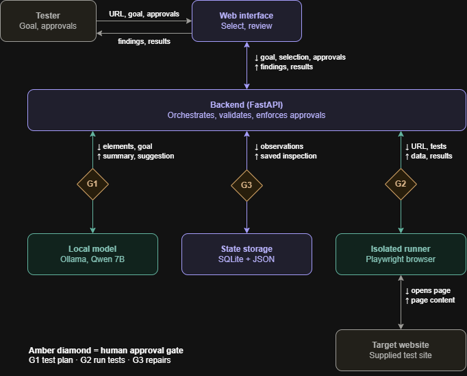

# Web Testing Assistant

A human-in-the-loop assistant that helps a tester inspect a web page, design test cases, generate Playwright code, run approved tests and maintain them when the page changes. Built for the *Generative AI for Software Testing* course project.

**Current status: Phase 1** (architecture and guided inspection). Page inspection and the web UI work. The model call, state storage and approval flow are still being built (see [Status](#status)).

## Architecture



| Component | Folder | Role |
|---|---|---|
| Web interface | `frontend/` | Plain HTML/CSS/JS. The tester enters a URL and scope, then reviews the findings. |
| Backend | `backend/` | FastAPI on :8000. Serves the UI and forwards requests to the runner. Will orchestrate the model and enforce approvals. |
| Runner | `runner/` | FastAPI on :8001. The only process that controls the browser (Playwright, Chromium). |
| Local model | `ollama/` | Ollama serving `qwen2.5-coder:7b`. |
| State storage | `data/` | Planned: SQLite and JSON for inspections, test cases and versions. |

Page content is treated as data, never as instructions. The UI renders it with `textContent` only.

## Run it

### Docker (everything, headless browser)

```bash
docker compose up --build
```

Open http://localhost:8000.

| Service | What it does |
|---|---|
| `backend` | Serves the UI and the `/api/inspect` endpoint on :8000 |
| `runner` | Headless Chromium via Playwright on :8001 (internal) |
| `ollama` | Ollama server. The model store is the host's `~/.ollama` (bind mount) |
| `ollama-pull` | One-shot: pulls the model only if the store doesn't have it |
| `ollama-warmup` | Keeps the model loaded so the first prompt is fast |

To inspect an app running on your machine, use `http://host.docker.internal:PORT`, not `localhost`.

### Local (visible browser)

The course brief asks for a visible browser, which a container can't show. Run the runner and backend on the host instead (needs Python 3.14 and [uv](https://docs.astral.sh/uv/)):

```bash
uv sync
uv run playwright install chromium

uv run uvicorn runner.server:app --port 8001     # terminal 1 (don't use --reload on Windows)
uv run uvicorn backend.main:app --port 8000      # terminal 2
```

Open http://localhost:8000. The browser window opens because `RUNNER_HEADLESS` is not set.

The backend talks to Ollama at `http://localhost:11434` by default (the Ollama app on your machine). If you use the Ollama container from `docker compose` instead, set `OLLAMA_URL=http://localhost:11435`.

To try the inspector alone:

```bash
uv run python runner/inspector.py https://example.com            # optional: "#css-scope", --headless
```

Reports are saved to `inspection_results/`.

## Configuration

Copy `.env.example` to `.env` to override the defaults.

| Variable | Default | Meaning |
|---|---|---|
| `OLLAMA_MODEL` | `qwen2.5-coder:7b` | Model to pull, warm up and call |
| `OLLAMA_HOME` | `~/.ollama` | Folder holding the Ollama model store |
| `BACKEND_PORT` | `8000` | Host port for the UI and API |
| `OLLAMA_PORT` | `11435` | Host port for Ollama (11435 avoids clashing with a host install) |
| `RUNNER_URL` | `http://localhost:8001` | Where the backend finds the runner (set by Docker) |
| `OLLAMA_URL` | `http://localhost:11434` | Where the backend finds Ollama (set by Docker) |
| `RUNNER_HEADLESS` | unset | `true` runs Chromium without a window (set by Docker) |

No API keys are used. The model runs locally.

## What the inspection returns

For each interactive element (links, buttons, inputs, selects, textareas, ARIA widgets, open shadow DOM):

- tag, visible text, label, key attributes, visibility and enabled state, parent form
- candidate Playwright locators, best first. Each one is run against the live page and marked `unique` (matches exactly one element) and `stable` (not position-based)
- page-level warnings: HTTP errors, iframes not inspected, truncated element lists

Everything is observed on the page, nothing is guessed.

## Saved data

Everything the assistant saves goes to `data/` (a mounted folder in Docker):

- `data/inspections/<host>_<timestamp>.json`: every inspection, exactly as the runner returned it. The model only ever sees elements from these files.
- `data/model_calls.jsonl`: one line per model call with the model, prompt and output tokens, and response time. Token counts come from Ollama.

## Status

| Area | State |
|---|---|
| Page inspection (elements, labels, attributes, locators) | Done |
| Web UI (URL, scope, goal, findings table, filter, element selection) | Done |
| Docker setup (backend, runner, Ollama, model pull/warmup) | Done |
| Saving inspections | Done |
| Model call over the selected elements, with token and timing logs | Done |
| Design document (`architecture.md`) | Planned |
| Test plan, Playwright code, execution, maintenance, versioning | Phase 2 |

## Project layout

```
backend/    FastAPI app (main.py), config.py, model_client.py, storage.py
frontend/   index.html, style.css, app.js
runner/     server.py (API), inspector.py (page inspection)
ollama/     pull-model.sh, warmup.sh
data/       saved inspections and the model usage log
docs/       design documents
```
