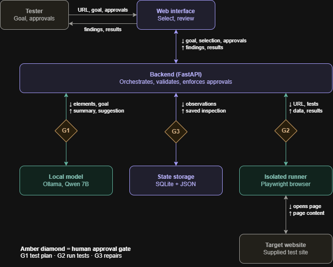

# Architecture (Phase 1)

A web assistant that helps a tester inspect a page. In Phase 1 the tester gives a URL, the assistant inspects the page in a browser, and a local model answers a question about the elements the tester selects. Test generation, execution and maintenance come in Phase 2.

## Components

| Component | Where | What it does |
|---|---|---|
| Web interface | `frontend/` | The tester enters a URL, an optional scope and a testing goal, ticks elements, and reads the findings and the model answer. |
| Backend | `backend/` | FastAPI app. Serves the interface, asks the runner to inspect, saves the result, and calls the model. |
| Isolated runner | `runner/` | A separate FastAPI service. The only part that opens a browser (Playwright, Chromium) and visits the target page. |
| Local model | Ollama, `qwen2.5-coder:7b` | Reads the selected elements and returns a short summary and one suggested next action. |
| State storage | `data/` | JSON files: one per inspection, plus a log of model calls. |
| Target website | any `http(s)` page | The page being tested. Only the runner talks to it. |

The backend never touches the target page. It only talks to the runner, the model and the storage.

## Data flow

1. The tester enters a URL (and optionally a scope and a goal) and clicks **Inspect**.
2. The backend sends the URL and scope to the runner (`POST /inspect`).
3. The runner opens the page, finds the interactive elements, builds candidate locators, and checks each locator on the live page.
4. The runner returns the findings. The backend saves them as `data/inspections/<host>_<time>.json` and returns them with an `inspection_id`.
5. The interface shows the findings. The tester ticks elements and clicks **Ask the model**.
6. The interface sends `inspection_id`, the goal and the selected element ids (`POST /api/summarize`).
7. The backend loads the saved inspection, takes the selected elements from it, and sends them with the goal to Ollama.
8. Ollama answers. The backend adds usage numbers (model, tokens, response time), writes them to `data/model_calls.jsonl`, and returns the answer to the interface.

## What the inspection contains

For every interactive element (links, buttons, inputs, selects, textareas, elements with ARIA roles, open shadow DOM):

- tag, visible text, label, and key attributes
- visible / enabled state and the form it belongs to
- candidate Playwright locators, best first. Each one shows how many elements it matched on the page (`match_count`), whether it is `unique` (matches exactly one) and whether it is `stable` (not based on position)

The report also has the page title, final URL, HTTP status, browser version, scan time and warnings (iframes not inspected, list truncated, HTTP error). All of it is observed on the page, nothing is guessed.

## Validation

- The URL must start with `http://` or `https://`. An invalid or missing scope selector returns an error.
- Locators are tested on the live page. Locators that match nothing are dropped. If no locator is unique, a position-based one is added and marked `stable: false`.
- The model only receives elements from a saved inspection. Selected ids that do not exist are rejected.
- The prompt tells the model to use only the given elements, not to invent locators or business rules, and to ask the tester when the goal is unclear.
- Page content is data. The interface shows it with `textContent` (never as HTML), and the prompt tells the model to treat element text as data, not as instructions.
- The model output is only shown to the tester. Nothing is executed in Phase 1.

## Approval points

In Phase 1 the tester controls every step: nothing runs unless they click **Inspect** or **Ask the model**, and they choose which elements the model sees. The model cannot change the page or run anything.

The diagram shows three approval gates that Phase 2 will add:

- **G1:** the tester approves the test plan before code is generated.
- **G2:** the tester approves before generated tests are run.
- **G3:** the tester approves before any repair to a test is applied.

## How later phases use the inspection data

Every inspection is saved, so later steps can refer to what was actually observed:

- **Test design and code generation:** tests will use the element ids and the unique, stable locators from the saved inspection. Locators will be checked against it before anything runs.
- **Execution:** the runner will run approved tests in its own process, with the page as the only target.
- **Maintenance:** a rescan will be compared with the saved inspection to find changed or missing locators and propose repairs, which the tester approves (G3).
- **Storage:** the diagram lists SQLite and JSON. Phase 1 uses JSON files only. SQLite is planned for test cases and versions.

## Resources and limits

- **Model:** `qwen2.5-coder:7b`, run locally by Ollama. No API key and no paid service.
- **Hardware used for the demo:** _Ryzen 7735 hs CPU, NVIDIA 4060 RTX laptop GPU, 16 GB RAM._
- **Model settings:** temperature 0.2, no streaming, request timeout 300 s.
- **Measured per call:** prompt tokens and output tokens (counted by Ollama) and response time, saved in `data/model_calls.jsonl`. Response time covers the model request only, not browser time.
- **Runner:** the scan stops at 300 elements, text and labels are cut at 80 characters, and the runner waits up to 5 s for the page to go idle. The backend waits up to 120 s for the runner.
- **Not covered yet:** iframes are not inspected, and the model may ignore part of a very large prompt because of its context size.

## Run modes

- **Docker:** backend, runner and Ollama in containers. The browser is headless.
- **Local:** the runner and backend run on the host with a visible browser window, which the Phase 1 brief asks for. Ollama runs on the host.

See `README.md` for the commands.
